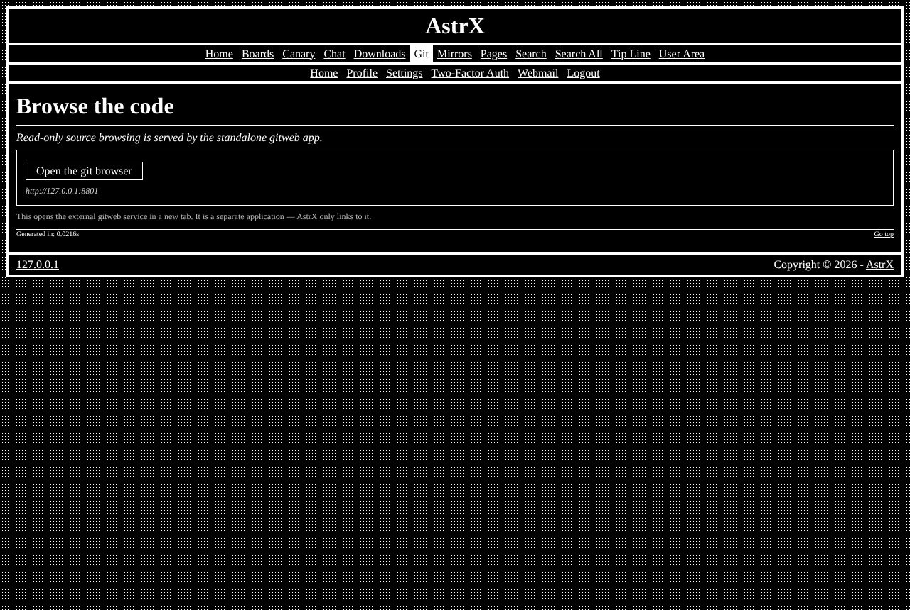

# astrx/module-gitbrowse

Browse git repositories inside the site: files, code, history and commits — the **Git browser** module of [AstrX](https://github.com/Vxmdzhb/astrx).



- Module key: `gitbrowse` (switch it on in the site's `resources/config/Modules.config.php`)
- Pages: `git_browse`, `admin_config_gitbrowse`
- Requires: `astrx/cms`, `astrx/framework`, `astrx/library`

The Code page lists the repositories of a git server and lets visitors walk
through them without leaving the site, in the site's theme and without
JavaScript: a repository's files and README, a file's code with line numbers,
the history page by page, and each commit with its colour-coded diff, plus
branches and a `git clone` line.

The server is [gitweb](https://github.com/Vxmdzhb/gitweb), from
[astrx-suite](https://github.com/Vxmdzhb/astrx-suite): the site reads its JSON
API and draws the pages itself. Point the site at it in **Admin → Git
server**:

| Setting | |
|---|---|
| Server address | where the site reaches gitweb, e.g. `http://127.0.0.1:8801`, or `http://gitweb:8801` inside Docker |
| Public address | where visitors clone from (shown as `git clone <address>/<repo>.git`); empty hides the line |
| User, Password | the account, when gitweb runs with `--auth`; an empty password field keeps the saved one |
| Timeout | seconds to wait for gitweb (1–10) |

The page saves to `GitBrowse.config.php` and then checks the connection by
listing the repositories. Every name, branch and path from the server is
checked before use, answers are capped in size, and code is shown as text,
never run or rendered.

This is the start of a self-hosted forge: later versions are meant to grow
towards what Gitea does (accounts, issues, pull requests), with gitweb as the
server.

It ships its own templates, catalogs (en, it), default configuration and SQL in
`resources/`; the site overrides any of them from its own `resources/`.

AstrX isn't on Packagist and doesn't tag versions: you install from each
repository's `main`, and your `composer.lock` pins the exact commit. Tell
Composer where to find the package and the AstrX packages it depends on:

```json
{
    "minimum-stability": "dev",
    "prefer-stable": true,
    "repositories": [
        { "type": "vcs", "url": "https://github.com/Vxmdzhb/module-gitbrowse" },
        { "type": "vcs", "url": "https://github.com/Vxmdzhb/cms" },
        { "type": "vcs", "url": "https://github.com/Vxmdzhb/framework" },
        { "type": "vcs", "url": "https://github.com/Vxmdzhb/library" }
    ]
}
```

Then:

```sh
composer require astrx/module-gitbrowse:dev-main
```

After that, list `AstrX\GitBrowse\GitBrowseModule::class` in the
site's `ApplicationModules::INSTALLED` and run the installer to create its
tables. See [modules](https://github.com/Vxmdzhb/astrx/blob/main/docs/MODULES.md).

Issues and pull requests are welcome here. [AstrX](https://github.com/Vxmdzhb/astrx)
is the site that puts all the packages together.
